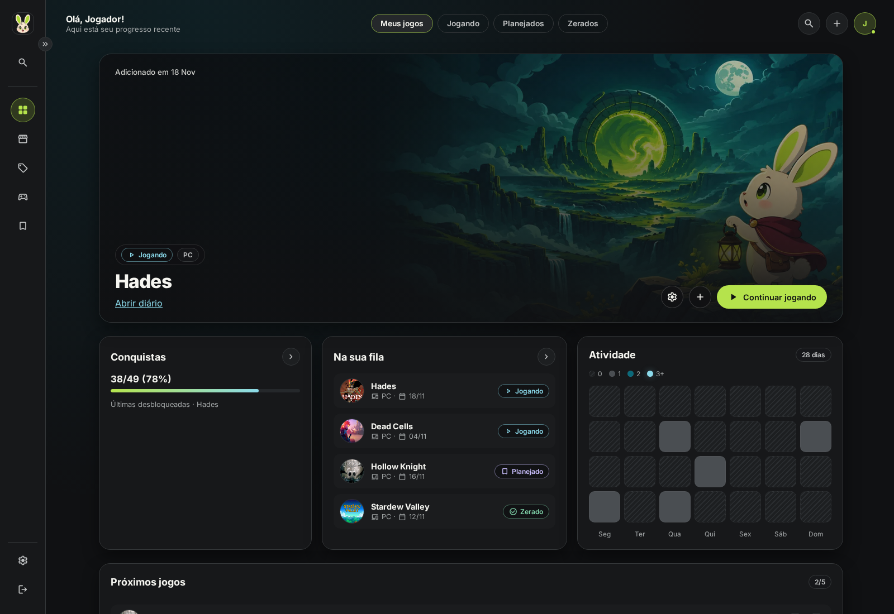
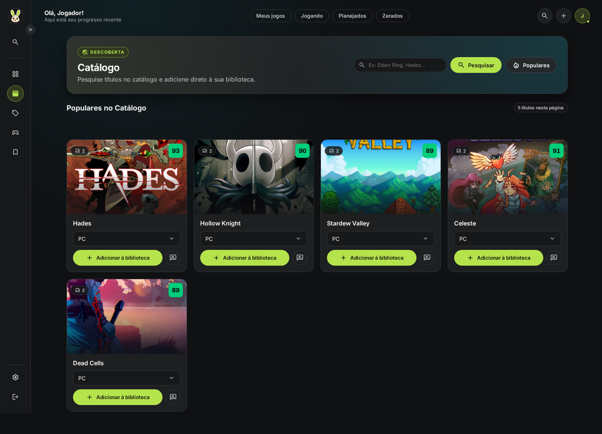
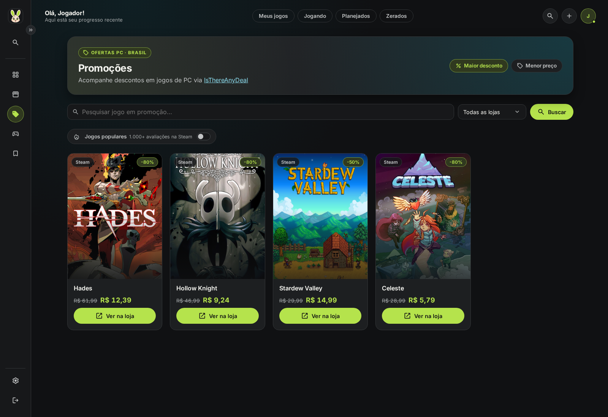
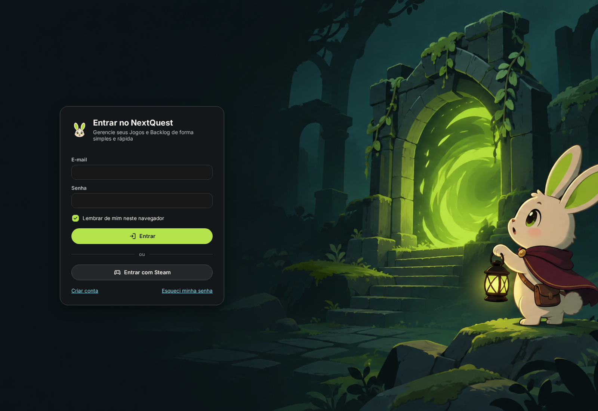

# NextQuest


[](https://github.com/Bruno23111/Gamesbacklog/releases)
[](https://dotnet.microsoft.com/)
[](https://learn.microsoft.com/dotnet/csharp/)
[](https://www.postgresql.org/)
[](https://www.docker.com/)
[](mobile/README.md)
[](specs/openapi-v1.json)
[](.github/workflows/api.yml)

> **NextQuest** é uma plataforma para organizar sua biblioteca e seu backlog de jogos, acompanhar o que está jogando e descobrir novos títulos e promoções.

O repositório adota **desenvolvimento orientado a especificações (Spec-Driven)** com arquitetura limpa em **ASP.NET Core 10**, contrato OpenAPI versionado e especificação completa de cliente **Flutter para Android**.

---

### 🏷️ Tópicos do GitHub

Os tópicos do repositório aparecem como etiquetas azuis no GitHub: `nextquest` · `games-backlog` · `game-library` · `game-tracker` · `gaming` · `dotnet` · `aspnet-core` · `clean-architecture` · `entity-framework-core` · `postgresql` · `angular` · `steam` · `discord` · `rawg` · `isthereanydeal` · `openapi` · `spec-driven-development`.

## 🖥️ Telas do sistema

Capturas do frontend NextQuest com dados demonstrativos.

### Biblioteca



### Catálogo



### Promoções



### Login



---

## 📑 Sumário

- [Visão Geral & Módulos](#-visão-geral--módulos)
- [Estrutura do Repositório](#-estrutura-do-repositório)
- [Endpoints da API](#-endpoints-da-api)
- [Pré-requisitos](#-pré-requisitos)
- [Desenvolvimento Local](#-desenvolvimento-local)
- [Testes Automatizados](#-testes-automatizados)
- [Especificações & Contratos](#-especificações--contratos)
- [Handoff Mobile (Flutter)](#-handoff-mobile-flutter)
- [Homologação & Deploy](#-homologação--deploy)
- [Notas e Termos de Uso](#-notas-e-termos-de-uso)

---

## 🚀 Visão Geral & Módulos

As especificações do projeto estão na pasta [`specs/`](specs/).

1. **Conta e Sessão ([Spec 001](specs/001-conta/spec.md))**
   - Cadastro seguro com confirmação via e-mail.
   - Autenticação e renovação de sessão com tokens opacos (*Bearer Tokens* do ASP.NET Core Identity).
   - Fluxo de recuperação e redefinição de senha com códigos seguros.
   - Rate limiting dedicado e e-mails locais via Mailpit.

2. **Biblioteca & Backlog ([Spec 002](specs/002-biblioteca/spec.md))**
   - Criação manual de itens no backlog com título e plataforma.
   - Status de jogo: *Quero Jogar*, *Jogando*, *Pausado*, *Zerado*, *Abandonado*.
   - Filtros por status, busca por texto e paginação.
   - Edição de status, notas e exclusão de itens com isolamento estrito por conta de usuário.

3. **Catálogo RAWG ([Spec 003](specs/003-catalogo/spec.md))**
   - Busca de jogos integrada ao catálogo global da RAWG.
   - Importação direta para o backlog com título, capa original e ID da plataforma.
   - Prevenção de duplicatas (status HTTP 409 em caso de importação duplicada).
   - Resiliência com fallback e rate limiting defensivo.

4. **Beta Android em Flutter ([Spec 004](specs/004-beta-android/spec.md))**
   - Especificação do aplicativo mobile multiplataforma (Android prioritário).
   - Tema escuro de alto contraste com capas de jogos em destaque.
   - Navegação inferior: *Biblioteca*, *Buscar* e *Conta*.
   - Detalhes de implementação e arquitetura em [mobile/README.md](mobile/README.md).

5. **Login Steam ([Spec 005](specs/005-login-steam/spec.md))** — Entrada e vínculo de conta via Steam.
6. **Biblioteca Steam ([Spec 006](specs/006-dados-steam/spec.md))** — Jogos, tempo jogado e progresso de conquistas.
7. **Perfil ([Spec 007](specs/007-perfil/spec.md))** — Nome de exibição, descrição, avatar e capa.

---

## 🗂️ Estrutura do Repositório

```text
Gamesbacklog/
├── .github/
│   └── workflows/api.yml        # Pipeline de Integração Contínua (CI)
├── .specify/                    # Memória de arquitetura e constituição Spec Kit
├── api/
│   ├── src/
│   │   ├── Domain/              # Entidades, Enums e regras de domínio
│   │   ├── Application/         # Casos de uso, interfaces de serviço e DTOs
│   │   ├── Infrastructure/      # EF Core, PostgreSQL, Identity e cliente RAWG
│   │   └── Api/                 # Minimal APIs, Endpoints, Middlewares e Program
│   ├── tests/
│   │   └── GamesBacklog.Tests/  # Testes unitários, de integração e snapshot OpenAPI
│   ├── Dockerfile               # Imagem de produção da API (.NET 10)
│   └── GamesBacklog.slnx        # Arquivo de solução moderno .NET
├── mobile/
│   └── README.md                # Diretrizes de implementação Flutter (Riverpod/Dio)
├── specs/
│   ├── 001-conta/               # Especificação de autenticação e identidade
│   ├── 002-biblioteca/          # Especificação do backlog pessoal
│   ├── 003-catalogo/            # Especificação da integração RAWG
│   ├── 004-beta-android/        # Especificação do cliente móvel Android
│   ├── examples/                # Fixtures e mocks JSON de requisições e respostas
│   └── openapi-v1.json          # Contrato OpenAPI v1 versionado
└── compose.yaml                 # PostgreSQL 18 e Mailpit para desenvolvimento local
```

---

## 📡 Endpoints da API

A API escuta por padrão em `/api/v1` e possui os seguintes grupos de rotas:

| Grupo | Método | Rota | Descrição |
|---|---|---|---|
| **Conta** | `POST` | `/api/v1/auth/register` | Cria uma nova conta |
| **Conta** | `GET` | `/api/v1/auth/confirmEmail` | Valida confirmação de e-mail |
| **Conta** | `POST` | `/api/v1/auth/login` | Realiza login e gera bearer token |
| **Conta** | `POST` | `/api/v1/auth/refresh` | Renova token expirado |
| **Conta** | `POST` | `/api/v1/auth/forgotPassword` | Solicita código de redefinição de senha |
| **Conta** | `POST` | `/api/v1/auth/resetPassword` | Aplica nova senha com o código |
| **Backlog** | `GET` | `/api/v1/backlog` | Lista itens do usuário com filtros e paginação |
| **Backlog** | `POST` | `/api/v1/backlog` | Cria manualmente um novo item no backlog |
| **Backlog** | `GET` | `/api/v1/backlog/{id}` | Obtém detalhes de um item |
| **Backlog** | `PATCH`| `/api/v1/backlog/{id}` | Atualiza status e metadados |
| **Backlog** | `DELETE`| `/api/v1/backlog/{id}` | Remove um item do backlog |
| **Backlog** | `POST` | `/api/v1/backlog/import` | Importa jogo a partir do catálogo RAWG |
| **Catálogo**| `GET` | `/api/v1/catalog/games` | Pesquisa títulos no catálogo RAWG |
| **Saúde** | `GET` | `/health` | Health check da aplicação |

---

## 🛠️ Pré-requisitos

- [.NET SDK 10.0+](https://dotnet.microsoft.com/download)
- [Docker](https://docs.docker.com/engine/install/) e [Docker Compose](https://docs.docker.com/compose/)
- [Chave de API RAWG](https://rawg.io/apidocs) *(opcional para rodar testes com mock; necessária para integração real do catálogo)*
- (Opcional) [Flutter SDK](https://docs.flutter.dev/get-started/install) para desenvolvimento do módulo móvel

---

## 💻 Desenvolvimento Local

### Executar com Docker Compose

Para iniciar o frontend, a API, o PostgreSQL e o Mailpit em containers (incluindo aplicação automática das migrações):

```bash
docker compose up -d --build --wait
```

- **Site**: [http://localhost:4201](http://localhost:4201) — encaminha as chamadas de `/api` para a API
- **API**: [http://localhost:5080](http://localhost:5080) — health check em `/health`
- **PostgreSQL**: `localhost:5432` (`gamesbacklog` / `local-dev-only`)
- **Mailpit**: [http://localhost:8025](http://localhost:8025)

Para encerrar os containers: `docker compose down`. Os dados do PostgreSQL permanecem no volume `postgres-data`.

#### Integrações no Docker local

O Compose carrega os arquivos opcionais `.env`, `.env.local` e `.env.development.local` nessa ordem. Se já tiver configurado as chaves em um deles, reaproveite o arquivo existente. Se precisar criar o primeiro arquivo de configuração, use o modelo na raiz do repositório:

```bash
cp -n .env.example .env.development.local
```

Preencha as credenciais no arquivo `.env.development.local` sem aspas. O Git ignora esse arquivo e o Compose o carrega somente no container da API. Os valores padrão sem segredo continuam em `appsettings.Development.json`; o Compose define as URLs locais do Docker.

| Recurso | Configuração |
|---|---|
| Catálogo | `Rawg__ApiKey` |
| Promoções | `IsThereAnyDeal__ApiKey` |
| Vídeos | `YouTube__ApiKey` |
| Login Steam | Use o site em `http://localhost:4201`. O retorno já está configurado no Compose. |
| Biblioteca e conquistas Steam | `Steam__ApiKey` |
| Vínculo com Discord | `Discord__ClientId`, `Discord__ClientSecret` e `Discord__RedirectUri`. Cadastre no OAuth2 do Discord a mesma URL de retorno do arquivo. |

Após editar o arquivo, recrie a API com `docker compose up -d --wait --force-recreate api`. Use `sudo` se sua sessão exigir. Se o Discord recusar o callback HTTP, use um endereço HTTPS que sirva o frontend e registre esse mesmo endereço no Discord e no arquivo local.

#### Administração do catálogo

Configure `Admin__UserIds` no arquivo de ambiente da API com os UUIDs das contas autorizadas, separados por vírgula. O ID pode ser consultado no PostgreSQL após criar a conta:

```bash
docker compose exec postgres psql -U gamesbacklog -d gamesbacklog
```

```sql
SELECT "Id" FROM "Users" WHERE "NormalizedEmail" = upper('seu-email@exemplo.com');
```

Reconstrua os serviços com `docker compose up -d --build --wait`. A API aplica a migração automaticamente. Entre com a conta autorizada, abra **Administração**, busque um título na RAWG e clique em **Adicionar ao catálogo**. O catálogo começa vazio. A busca, os detalhes, as avaliações e a importação para a biblioteca dos usuários usam os jogos já publicados no PostgreSQL.

Em **Administração → Gerenciar promoções**, consulte o IsThereAnyDeal com a chave `IsThereAnyDeal__ApiKey` e publique as ofertas desejadas. A página **Promoções** começa vazia e lê as ofertas publicadas no PostgreSQL. Cada oferta fica visível por até 24 horas a partir da consulta. Consulte e publique novamente para atualizar a oferta.

Em **Adicionar jogos em lote**, escolha **Populares** ou **Novidades** e uma quantidade entre 10, 50, 100, 200 e 500. Novidades reúne lançamentos dos últimos 12 meses, dos mais recentes para os mais antigos na prévia. Consulte a prévia da RAWG, escolha os títulos e confirme. Títulos já publicados podem ser selecionados para receber a marca da lista, sem duplicar o jogo. Os filtros do catálogo usam essas marcas no PostgreSQL.

Em Promoções, o lote consulta o ranking do IsThereAnyDeal e publica apenas os títulos que têm desconto disponível no Brasil. O lote preserva registros existentes, inclusive ofertas expiradas. Para renovar uma oferta, use a publicação individual.

#### Vídeos de jogos

Habilite a **YouTube Data API v3** no seu projeto Google Cloud e configure a chave em `YouTube__ApiKey` no arquivo de ambiente da API. Em **Administração → Vídeos**, busque vídeos no YouTube ou cole um link, escolha a categoria e, se quiser, vincule um jogo publicado no catálogo. O mesmo vídeo aparece apenas uma vez e pode ser retirado da aba pelo administrador.

A aba **Vídeos** consulta o PostgreSQL para listar e filtrar as publicações. O player do YouTube só é carregado ao clicar em **Assistir**, quando o vídeo permite reprodução integrada. A API atualiza periodicamente os metadados dos vídeos publicados em pequenos lotes e retira vídeos que deixaram de estar disponíveis.

#### Amigos e lista de desejos

Em **Amigos**, copie o seu código para compartilhar ou informe o código de outro jogador para enviar um pedido. Depois que ele aceitar, abra o perfil para ver os jogos marcados como **Jogando**, a biblioteca e a lista de desejos. Somente amigos aceitos têm acesso a esses dados, e as anotações da biblioteca são privadas.

O código de amizade é aleatório e separado do ID da conta. **Gerar novo código** invalida o código anterior para novos pedidos. As amizades e os pedidos já enviados continuam válidos.

No catálogo, use **Adicionar aos desejos** para salvar um título. A aba **Lista de desejos** mostra os jogos salvos e permite removê-los.

#### PlayStation

A aba **PlayStation** mostra os jogos PlayStation da biblioteca NextQuest, incluindo títulos adicionados pelo catálogo. É possível adicionar um jogo e registrar manualmente os troféus por título.

**Sincronizar com a PSN** aceita um token de acesso PSN já emitido com permissão para consultar troféus da própria conta. Use o formulário em HTTPS ou em localhost. O NextQuest usa o token somente na consulta, sem salvá-lo no banco ou no navegador. A prévia fica disponível por dez minutos e mostra até 500 títulos da lista de troféus. Depois que você escolher os títulos e confirmar, o NextQuest salva os jogos e as contagens no PostgreSQL. Novas importações reconhecem o identificador PSN já salvo. Quando houver exatamente um jogo local com o mesmo título e plataforma, o NextQuest aproveita esse registro e preserva seu status e suas anotações.

Para habilitar **Conectar conta PSN**, configure os valores `PsnOAuth__*` de um cliente OAuth que a Sony tenha autorizado a consultar os dados de troféus. Use os endpoints e o escopo fornecidos para esse cliente. A configuração aceita código de autorização com PKCE S256 e, para clientes confidenciais, autenticação `client_secret_basic`.

Registre `https://seu-dominio/api/v1/playstation/sync/oauth/callback` como `PsnOAuth__RedirectUri` e configure `https://seu-dominio/playstation` em `PsnOAuth__WebReturnUrl`. Ambos devem usar a mesma origem HTTPS do frontend. Habilite o proxy de `/api` nessa origem e mantenha parâmetros de callback fora dos logs do proxy. O botão aparece quando a configuração está completa. O login ocorre no domínio da Sony e retorna uma prévia ao NextQuest. O fluxo usa a autorização para uma consulta e descarta os tokens, incluindo eventual token de renovação.

A disponibilidade de um cliente autorizado para o NextQuest ainda precisa ser confirmada com a Sony. Esta etapa consulta a lista de troféus e ainda não sincroniza compras nem horas jogadas.

### 1. Iniciar serviços de suporte

Inicie o banco de dados PostgreSQL e o servidor SMTP local (Mailpit):

```bash
docker compose up -d --wait postgres mailpit
```

- **PostgreSQL**: `localhost:5432` (`gamesbacklog` / `local-dev-only`)
- **Mailpit Web UI**: [http://localhost:8025](http://localhost:8025) *(para visualizar e-mails de confirmação e recuperação)*

### 2. Executar migrações do banco

```bash
dotnet run --project api/src/Api -- --migrate
```

### 3. Iniciar a API

```bash
export ASPNETCORE_ENVIRONMENT=Development
# Opcional: configure sua chave RAWG para ativar o catálogo real
export Rawg__ApiKey="sua-chave-rawg"

dotnet run --project api/src/Api -- --urls http://127.0.0.1:5080
```

- Documentação OpenAPI / Swagger: [http://localhost:5080/openapi/v1.json](http://localhost:5080/openapi/v1.json)
- Health check: [http://localhost:5080/health](http://localhost:5080/health)

---

## 🧪 Testes Automatizados

Execute a suíte completa de testes unitários e de integração:

```bash
# Executa testes rápidos (in-memory / mocks)
dotnet test api/GamesBacklog.slnx

# Valida e sincroniza o snapshot do contrato OpenAPI
GAMESBACKLOG_EXPORT_OPENAPI="$PWD/specs/openapi-v1.json" \
  dotnet test api/GamesBacklog.slnx --filter FullyQualifiedName~OpenApiSnapshot
```

### Testes com PostgreSQL Real

Com o Docker Compose ativo, defina a variável `GAMESBACKLOG_TEST_POSTGRES` para executar os testes de concorrência e isolamento multi-tenant:

```bash
GAMESBACKLOG_TEST_POSTGRES="Host=localhost;Database=gamesbacklog;Username=gamesbacklog;Password=local-dev-only" \
  dotnet test api/GamesBacklog.slnx
```

---

## 📐 Especificações & Contratos

O projeto adota a metodologia de desenvolvimento dirigido por especificações do **GitHub Spec Kit**:

- **Constituição**: Regras centrais e diretrizes de design em [`.specify/memory/constitution.md`](.specify/memory/constitution.md).
- **Ciclo de Desenvolvimento**: `specify` → `clarify` → `plan` → `tasks` → `analyze` → `implement` → `converge`.
- **Contrato OpenAPI**: Mantido sob controle de versão em [`specs/openapi-v1.json`](specs/openapi-v1.json), validado continuamente pelo teste `OpenApiSnapshotMatchesEndpointMetadata`.
- **Exemplos de Payload**: Payloads de exemplo para desenvolvimento offline e mock em [`specs/examples/`](specs/examples/).

---

## 📱 Handoff Mobile (Flutter)

O diretório [`mobile/`](mobile/) contém as instruções para o desenvolvimento do aplicativo móvel Android em Flutter:

- Gerenciamento de estado: **Riverpod**
- Cliente HTTP: **Dio**
- Roteamento: **go_router**
- Configuração de URL base para desenvolvimento com emulador Android:
  ```bash
  flutter run --dart-define=API_BASE_URL=http://10.0.2.2:5080
  ```

Consulte [mobile/README.md](mobile/README.md) para orientações detalhadas sobre navegação, temas e tratamento de erros.

---

## 🚢 Homologação & Deploy

### Construção da imagem Docker

```bash
docker build -f api/Dockerfile -t gamesbacklog-api .
```

### Executar migrações em homologação

```bash
docker run --rm --env-file staging.env gamesbacklog-api --migrate
```

### Variáveis de ambiente principais

| Variável | Descrição | Exemplo |
|---|---|---|
| `ConnectionStrings__Backlog` | String de conexão com o PostgreSQL | `Host=db;Database=gamesbacklog;...` |
| `Auth__PublicOrigin` | Origem pública para links de e-mail | `https://api.gamesbacklog.com` |
| `Auth__KeyDirectory` | Diretório persistente para chaves de dados | `/var/keys` |
| `Smtp__Host` | Servidor SMTP para disparo de e-mails | `smtp.provedor.com` |
| `Smtp__Port` | Porta SMTP | `587` |
| `Smtp__From` | Remetente de e-mails do sistema | `noreply@gamesbacklog.com` |
| `Rawg__ApiKey` | Chave de integração do catálogo RAWG | `abc123xyz` |
| `Proxy__KnownAddress` | IP do proxy reverso para terminação TLS | `10.0.0.1` |

---

## ⚠️ Notas e Termos de Uso

- **Catálogo RAWG**: O plano gratuito é destinado ao desenvolvimento e uso pessoal. Antes de qualquer monetização ou distribuição comercial, confirme os termos em [Planos RAWG](https://rawg.io/apidocs) e [Termos da API RAWG](https://rawg.io/tos_api).
- **Segurança de Tokens**: Os tokens de autenticação gerados pelo ASP.NET Core Identity são opacos e protegidos criptograficamente. Certifique-se de configurar um volume persistente para `Auth__KeyDirectory` em ambientes produtivos.

## Login com Steam

A integração usa Steam OpenID 2.0 para entrar ou vincular uma conta existente. A configuração usa a origem da API em `Auth__PublicOrigin` e a rota do app em `Steam__WebReturnUrl`. O ambiente de desenvolvimento aponta para `http://127.0.0.1:5080` e `https://localhost:4200/auth/steam/callback` (Angular). Configure URLs HTTPS no ambiente de homologação. Em proxy reverso, preserve o cabeçalho Host e encaminhe o protocolo original conforme a configuração de proxy da API.

Aplique as migrations antes de usar os endpoints. A origem da URL Flutter configurada é liberada para requisições do navegador. A autenticação guarda o SteamID verificado e usa a sessão bearer do GamesBacklog. Quem já tem biblioteca vinculada a um e-mail deve entrar por e-mail e então vincular a Steam para preservar a mesma conta.

O [guia Flutter](specs/005-login-steam/flutter.md) detalha o retorno do navegador e a troca de código. O login via navegador usa o OpenID Steam e dispensa chave da Steam Web API. [Documentação Steamworks](https://partner.steamgames.com/doc/features/auth)
